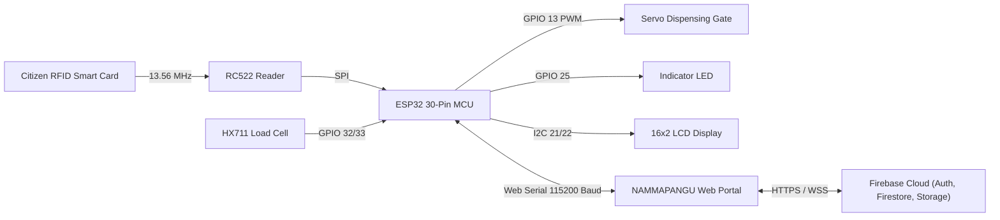

# NAMMAPANGU – நம்ம பங்கு
## Tamil Nadu Smart Ration Distribution & RFID Inventory Management System

> [!IMPORTANT]
> **PROTOTYPE DEMONSTRATION NOTICE**:  
> **NAMMAPANGU (நம்ம பங்கு)** is an advanced engineering prototype and academic research initiative inspired by the Public Distribution System (PDS) of Tamil Nadu, India. It does **not** falsely claim official government endorsement, represent live statutory ration databases, or replace the official Tamil Nadu Civil Supplies Corporation (TNCSC) / TNEPDS production infrastructure.

---

## 1. SYSTEM ARCHITECTURE & OVERVIEW

NAMMAPANGU modernizes fair-price ration distribution by integrating:
1. **Contactless Smart Card Identification**: High-frequency RFID (RC522 ISO/IEC 14443A) citizen identification.
2. **Cryptographic 6-Digit PIN Authentication**: Salted SHA-256 client/cloud PIN verification preventing unauthorized card usage.
3. **Precision Automated Gravimetric Dispensing**: High-precision strain gauge Load Cell + HX711 amplifier coupled with an ESP32-actuated servo gate ensuring commodities are dispensed strictly according to actual measured weight.
4. **Cloud Firestore Single Source of Truth**: Instant cross-device synchronization between warehouse godowns, regional supply offices, and outlet terminals.



---

## 2. HARDWARE SPECIFICATIONS & STRICT PERIPHERAL RULES

### Authorized Components:
- **Microcontroller**: ESP32 30-Pin Development Board (NodeMCU / DevKit V1)
- **RFID Reader**: MFRC522 (13.56 MHz)
- **Load Cell Amplifier**: HX711 24-bit ADC
- **Load Cell**: Strain gauge sensor (1 KG, 5 KG, or 10 KG capacity)
- **Display**: 16x2 LCD with PCF8574 I2C Backpack (Address `0x27` or `0x3F`)
- **Dispensing Actuator**: 1x Micro Servo Motor (SG90 / MG996R)
- **Status Indicator**: 1x External LED (Green) with 220Ω - 330Ω current-limiting resistor

> [!CAUTION]
> **STRICT HARDWARE RESTRICTION**: Use **ONLY** the components listed above.  
> **DO NOT INCLUDE**:
> - HC-SR04 ultrasonic sensors
> - Extra LEDs
> - Extra RFID readers
> - Extra servo motors
> - Unrequested sensors or actuators

### ESP32 30-Pin Microcontroller Pinout Table:

| Component | Pin Function | ESP32 GPIO | Operating Voltage | Connection Instructions |
| :--- | :--- | :--- | :--- | :--- |
| **RC522 RFID** | SDA / SS | **GPIO 5** | 3.3V | Connect to 3.3V pin (**DO NOT USE 5V**) |
| | SCK | **GPIO 18** | 3.3V | SPI Clock |
| | MOSI | **GPIO 23** | 3.3V | SPI Master-Out Slave-In |
| | MISO | **GPIO 19** | 3.3V | SPI Master-In Slave-Out |
| | RST | **GPIO 4** | 3.3V | Reset pin |
| | GND | GND | 0V | Common Ground |
| **HX711 Load Cell** | DT / DOUT | **GPIO 32** | 3.3V / 5V | Digital Serial Data |
| | SCK | **GPIO 33** | 3.3V / 5V | Serial Clock |
| | E+, E-, A+, A- | Bridge Wires | — | Red (E+), Black (E-), White (A-), Green (A+) |
| **I2C LCD (16x2)** | SDA | **GPIO 21** | 5V / 3.3V | I2C Serial Data |
| | SCL | **GPIO 22** | 5V / 3.3V | I2C Serial Clock |
| **Servo Motor** | Signal (PWM) | **GPIO 13** | 5V | PWM Control Pin |
| | VCC (Power) | External 5V | 5V (2A) | **Do not draw power from ESP32 pins!** |
| | GND | Common GND | 0V | Connect external GND with ESP32 GND |
| **Single LED** | Anode (+) | **GPIO 25** | 3.3V | In series with 220Ω resistor |
| | Cathode (-) | GND | 0V | Common Ground |

---

## 3. PROJECT DIRECTORY STRUCTURE

```
NAMMAPANGU/
├── public/
│   ├── index.html            # Portal overview & architecture specification
│   ├── login.html            # Single administrator authentication portal
│   ├── dashboard.html        # Real-time Firestore statistics & operational feeds
│   ├── users.html            # Citizen smart card enrollment & quota audit
│   ├── scanner.html          # PRIMARY SCREEN: Live RFID scanner & 6-digit PIN pad
│   ├── inventory.html        # Items catalog & godown inward stock replenishment
│   ├── distribution.html     # Precision load cell dispensing console & tare controls
│   ├── transactions.html     # Immutable distribution transaction ledger
│   ├── reports.html          # CSV/Excel export & printable ration receipt generator
│   ├── hardware.html         # Web Serial manager (115200 baud) & device telemetry
│   ├── settings.html         # Shop code, taluk identity & load cell calibration
│   │
│   ├── assets/
│   │   ├── css/
│   │   │   ├── style.css         # Tamil Nadu inspired design system & variables
│   │   │   ├── dashboard.css     # Metric cards, progress bars & split grids
│   │   │   ├── components.css    # PIN pad, LCD meters, radar animation & tables
│   │   │   └── responsive.css    # Mobile drawer, tablet grids & print styles
│   │   │
│   │   ├── js/
│   │   │   ├── firebase-config.js # Firestore, Auth, Storage initialization
│   │   │   ├── auth.js            # Admin authentication & session persistence
│   │   │   ├── common.js          # Route protection, clocks, toasts & crypto hash
│   │   │   ├── dashboard.js       # Real-time Firestore analytics listeners
│   │   │   ├── users.js           # Citizen CRUD, photo upload & RFID enrollment
│   │   │   ├── scanner.js         # PRIMARY SCREEN controller & PIN lockout engine
│   │   │   ├── inventory.js       # Available stock gauges & overflow validation
│   │   │   ├── distribution.js    # Load cell tare, servo gate & atomic deductions
│   │   │   ├── transactions.js    # Filterable ledger & server timestamp audit
│   │   │   ├── reports.js         # Daily/Weekly/Monthly CSV report generators
│   │   │   └── hardware.js        # Web Serial API manager & hardware simulator
│   │   │
│   │   └── images/
│   │       ├── Tamil_nadu_logo.png # Official Tamil Nadu Government Emblem
│   │       └── CM Vijay.jpg        # Hon'ble Chief Minister Portrait (Prototype)
│   │
│   └── favicon.ico
│
├── esp32/
│   ├── nammapangu_esp32.ino   # Core microcontroller setup & state machine
│   ├── config.h               # GPIO pin mappings, calibration factor & baud rate
│   ├── rfid_module.h          # MFRC522 SPI driver & uppercase hex UID converter
│   ├── loadcell_module.h      # HX711 24-bit strain gauge driver with stability check
│   ├── servo_module.h         # ESP32 PWM servo gate actuator driver (0° / 90°)
│   ├── lcd_module.h           # LiquidCrystal_I2C 16x2 bilingual status display
│   ├── communication.h        # 115200 Baud bidirectional JSON parser/emitter
│   └── README.md              # Microcontroller wiring diagrams & calibration steps
│
├── functions/
│   ├── index.js               # Cloud Functions: verifyUserPin, executeDistribution
│   ├── package.json           # Cloud Functions dependencies
│   └── helpers/
│       └── pinSecurity.js     # Cryptographic salted hash engine
│
├── firebase/
│   ├── firestore.rules        # Strict security rules protecting PINs & ledgers
│   ├── storage.rules          # Max 2MB image constraints for citizen photos
│   ├── firestore.indexes.json # Composite indexes for high-speed queries
│   └── firebase.json          # Deployment target configuration
│
├── .env.example               # Environment variables specification
├── .gitignore                 # Excludes secrets, credentials, and build caches
├── package.json               # NPM scripts for local development
├── vercel.json                # Vercel production hosting & routing configuration
└── README.md                  # Master documentation
```

---

## 4. STEP-BY-STEP FIREBASE SETUP & DEPLOYMENT

### Step 1: Create Firebase Project
1. Navigate to [Firebase Console](https://console.firebase.google.com/).
2. Click **Add Project** and name it `nammapangu-pds` (or your chosen project ID).
3. Disable Google Analytics (optional) and create the project.

### Step 2: Enable Firebase Authentication
1. Go to **Build > Authentication > Sign-in method**.
2. Enable **Email/Password** provider.
3. Add your primary administrator account:
   - **Email**: `admin@nammapangu.tn.gov.in`
   - **Password**: `Admin@TN2026` (or your chosen secure password)

### Step 3: Create Cloud Firestore Database
1. Go to **Build > Firestore Database**.
2. Click **Create database** and select your preferred region (e.g., `asia-south1` for Mumbai, India).
3. Choose **Start in production mode**.

### Step 4: Create Firebase Storage
1. Go to **Build > Storage**.
2. Click **Get started**, select the default bucket, and accept production rules.

### Step 5: Install Firebase CLI & Deploy Security Rules
Open your terminal in the `nammapangu` project root and execute the exact commands:

```bash
# 1. Install Firebase CLI globally (if not installed)
npm install -g firebase-tools

# 2. Authenticate with your Google account
firebase login

# 3. Associate with your project
firebase use YOUR_PROJECT_ID

# 4. Deploy Firestore Security Rules
firebase deploy --only firestore:rules

# 5. Deploy Firestore Composite Indexes
firebase deploy --only firestore:indexes

# 6. Deploy Firebase Storage Rules
firebase deploy --only storage

# 7. Deploy Firebase Cloud Functions
firebase deploy --only functions
```

---

## 5. LOCAL RUNNING & VERCEL DEPLOYMENT

### Run Locally:
```bash
# Start local development server
npm start
# Opens at http://localhost:3000 (or http://localhost:8080 with npm run serve)
```

### Deploy to Vercel:
```bash
# Install Vercel CLI
npm install -g vercel

# Deploy directly to production
vercel --prod
```

Configure your environment variables in Vercel Project Settings according to `.env.example`.

---

## 6. END-TO-END OPERATIONAL WORKFLOW

1. **Administrator Login**:
   - Access `login.html`.
   - Authenticate with administrator credentials.
   - The system automatically redirects to `scanner.html` (Primary Screen).

2. **Citizen Identification (RFID Scan)**:
   - Citizen taps their RFID Smart Card on the RC522 reader.
   - ESP32 reads UID (e.g., `A1B2C3D4`) and transmits: `{"type":"RFID","uid":"A1B2C3D4"}`.
   - Web application queries Firestore `users`.
   - Profile card displays citizen photograph, name, masked Aadhaar, and remaining monthly quota.

3. **6-Digit PIN Authentication**:
   - Web application activates on-screen keypad.
   - Citizen enters their confidential 6-digit PIN.
   - Input is hashed with salt: $\text{SHA-256}(\text{PIN} + \text{salt})$.
   - If incorrect: Attempt counter decrements (3 maximum attempts before 5-minute security lockout).
   - If verified: Routes directly to `distribution.html`.

4. **Automated Gravimetric Dispensing**:
   - Select commodity (e.g. Rice, Sugar, Wheat).
   - Place container on load cell platform and click **TARE** (zeros the scale).
   - Click **START DISPENSING** with target weight (e.g., 1.00 KG).
   - Web app dispatches: `{"command":"DISPENSE","target":1.0}`.
   - ESP32 opens Servo (GPIO 13 to 90°).
   - HX711 streams live weight to web gauge every 200ms.
   - When target weight is reached, servo gate snaps closed (0°).
   - ESP32 confirms stable final weight (e.g., 1.02 KG).
   - Web application deducts actual measured weight from Firestore inventory, updates monthly entitlement, and writes immutable transaction record.
   - Citizen collects printable receipt.

---

## 7. HARDWARE TESTING & SIMULATOR MODE

If an ESP32 is not currently plugged into your workstation:
1. Navigate to **Hardware Connection** in the sidebar.
2. Click **Toggle Simulator Mode**.
3. You can simulate RFID scans, scale tare, and automated dispensing directly in the browser!
4. When a physical ESP32 is connected via USB, click **Connect ESP32 (Web Serial)** to bind directly to the hardware COM port at 115200 baud.

---

## 8. TROUBLESHOOTING GUIDE

| Symptom | Root Cause | Solution |
| :--- | :--- | :--- |
| **"Web Serial not supported"** | Using unsupported browser (Firefox/Safari) | Use Chrome, Microsoft Edge, or Opera with Web Serial enabled. |
| **RC522 reader not detecting cards** | Incorrect SPI wiring or 5V power | Ensure 3.3V power (NOT 5V). Verify GPIO 5(SDA), 18(SCK), 23(MOSI), 19(MISO), 4(RST). |
| **HX711 gives negative or erratic values** | Calibration factor or loose strain gauge wires | Verify wires: Red (E+), Black (E-), White (A-), Green (A+). Run Tare before dispensing. |
| **Servo jitters or resets ESP32** | Power surge from drawing current from ESP32 | Power the servo from an external regulated 5V (2A) supply with common GND. |
| **Firestore "Permission Denied"** | Unauthenticated user or rules deployed incorrectly | Verify administrator is logged in via `login.html`. Re-run `firebase deploy --only firestore:rules`. |
| **Invalid Card / User Not Found** | Unregistered UID scanned | Navigate to **Users** page and click **SCAN FOR NEW USER** to register the card UID. |
